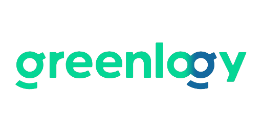

  

<h1>Greenlogy – Virtuálna batéria pre Home Assistant</h1>

  
  
  

Vlastná integrácia (<em>Custom Component</em>) pre Home Assistant na automatické načítanie dát o stave, zostatku a bilancii virtuálnej batérie zo zákazníckeho portálu <strong>Greenlogy</strong>.

<h2>📦 Inštalácia</h2>

<h3>Možnosť 1: Cez HACS (Odporúčané)</h3>
<ol>
  <li>Otvorte <strong>HACS</strong> vo vašom Home Assistante.</li>
  <li>V pravom hornom rohu kliknite na ikonu troch bodiek (<code>⋮</code>) a zvoľte <strong>Vlastné repozitáre</strong> (<em>Custom repositories</em>).</li>
  <li>Do poľa pre repozitár vložte URL adresu a ako kategóriu vyberte <strong>Integrácia</strong> (<em>Integration</em>):
    <pre><code>https://github.com/marianbezeg/ha-greenlogy</code></pre>
  </li>
  <li>Kliknite na <strong>Pridať</strong>, vyhľadajte <strong>Greenlogy</strong> a nainštalujte integráciu.</li>
  <li><strong>Reštartujte Home Assistant</strong>.</li>
</ol>

<h3>Možnosť 2: Manuálna inštalácia</h3>
<ol>
  <li>Stiahnite si najnovšie vydanie (<em>Release</em>) z tohto repozitára.</li>
  <li>Skopírujte priečinok <code>custom_components/greenlogy</code> do vášho priečinka <code>/config/custom_components/</code> v Home Assistante.</li>
  <li><strong>Reštartujte Home Assistant</strong>.</li>
</ol>

<h2>⚙️ Konfigurácia</h2>
<ol>
  <li>V Home Assistante prejdite do <strong>Nastavenia -&gt; Zariadenia a služby</strong>.</li>
  <li>Vpravo dole kliknite na <strong>+ Pridať integráciu</strong> a vyhľadajte <strong>Greenlogy</strong>.</li>
  <li>Zadajte prihlasovacie údaje do zákazníckeho portálu Greenlogy.</li>
</ol>

<h2>⚡ Tip pre majiteľov FVE: Výpočet dnešného čerpania a reálneho zostatku VB</h2>

Dáta na portáli Greenlogy sa aktualizujú s oneskorením (podľa spracovania dát z distribučnej sústavy, zvyčajne 1–2 dni). Ak máte doma FVE a meriate celkový <strong>Import zo siete</strong> a <strong>Export do siete</strong> (napr. cez Smart Meter striedača alebo elektromer), môžete si v Home Assistante vytvoriť pomocné senzory. Tie vám ukážu, <strong>koľko energie ste dnes reálne z virtuálnej batérie odobrali alebo do nej uložili</strong>.

Pridajte nasledujúci kód do vášho <code>configuration.yaml</code> (názvy entít <code>sensor.fve_import</code> a <code>sensor.fve_export</code> nahraďte vašimi reálnymi senzormi):

<pre><code># 1. Denné počítadlá (Utility Meter) pre dnešný import a export
utility_meter:
  fve_denny_import:
    source: sensor.fve_import # &lt;-- ZMEŇTE na váš senzor celkového odberu zo siete (kWh)
    cycle: daily
  fve_denny_export:
    source: sensor.fve_export # &lt;-- ZMEŇTE na váš senzor celkovej dodávky do siete (kWh)
    cycle: daily

# 2. Výpočet dnešnej bilancie a aktuálneho odhadovaného zostatku vo VB
template:
  - sensor:
      - name: "Greenlogy Dnes Odobraté z VB"
        unique_id: greenlogy_dnes_odobrate_z_vb
        unit_of_measurement: "kWh"
        device_class: energy
        state_class: total
        icon: mdi:battery-arrow-down
        state: &gt;
          
          
          {{ [0, (imp - exp)] | max | round(2) }}

      - name: "Greenlogy Dnes Uložené do VB"
        unique_id: greenlogy_dnes_ulozene_do_vb
        unit_of_measurement: "kWh"
        device_class: energy
        state_class: total
        icon: mdi:battery-arrow-up
        state: &gt;
          
          
          {{ [0, (exp - imp)] | max | round(2) }}

      - name: "Greenlogy Odhadovaný Aktuálny Zostatok VB"
        unique_id: greenlogy_odhadovany_zostatok_vb
        unit_of_measurement: "kWh"
        device_class: energy
        icon: mdi:battery-sync
        state: &gt;
           {# &lt;-- ZMEŇTE na názov vášho senzora zostatku z Greenlogy #}
          
          
          {{ (vb_portal + exp - imp) | round(2) }}</code></pre>

<h3>Čo tieto senzory robia?</h3>
<ul>
  <li><strong>Greenlogy Dnes Odobraté z VB:</strong> Ak ste dnes zo siete odobrali viac, ako ste dodali (napr. zamračený deň), senzor ukazuje, koľko kWh ste si dnes reálne „potiahli“ z vašej virtuálnej batérie. Ak ste viac dodali ako odobrali, ukazuje <code>0 kWh</code>.</li>
  <li><strong>Greenlogy Dnes Uložené do VB:</strong> Ukazuje čistý dnešný prebytok, ktorý sa vám pripíše do virtuálnej batérie.</li>
  <li><strong>Greenlogy Odhadovaný Aktuálny Zostatok VB:</strong> Vezme posledný známy zostatok z portálu Greenlogy a v reálnom čase k nemu pripočíta alebo odpočíta dnešnú bilanciu.</li>
</ul>
